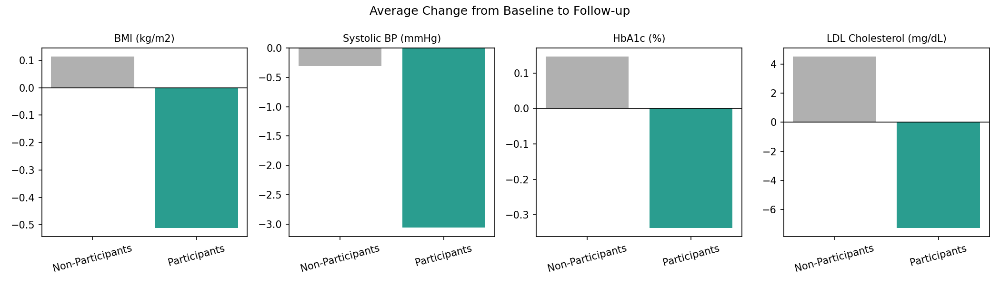

# Health Improvement Programs Analysis
### 🇸🇦 تحليل برامج تحسين الصحة
## 🇬🇧 English

### 📋 Overview
This project compares health outcomes between patients who joined a hospital-run **Health Improvement Program (HIP)** and a comparison group who did not. It shows a complete analysis workflow: simulate the data, compare the groups, test the differences statistically, and report the results honestly.

> **Note on data:** All data is **synthetic** (500 simulated patient records generated by `generate_data.py`). It was created for portfolio and methodology-demonstration purposes. No real patient data is used. The program effects are assumptions set in the generator, so the results show how the analysis works, not what a real program achieves.

### 🎯 Objective
Compare baseline-to-follow-up changes in BMI, systolic blood pressure, HbA1c, and LDL cholesterol between participants and non-participants, and compare 90-day readmission rates.

### 🗂️ Dataset
| | |
|---|---|
| Total patients | 500 |
| Program participants | 260 |
| Comparison group | 240 |
| Departments | Cardiology, Endocrinology, Internal Medicine, Family Medicine |
| Time in program | 6 to 12 months |
| Fields | Age, gender, department, baseline and follow-up BMI, systolic BP, HbA1c, LDL, program adherence %, satisfaction score, 90-day readmission |

### 🔧 Tools
Python (pandas, NumPy, Matplotlib, SciPy). The CSV can also be opened in Excel or Power BI.

### ▶️ How to reproduce
```bash
pip install pandas numpy matplotlib scipy
python generate_data.py        # creates the synthetic dataset
python analyze.py              # summary table and charts
python statistical_tests.py    # significance tests and adjusted analysis
```

### 📊 Key Findings

**Average change from baseline to follow-up:**

| Metric | Participants | Comparison group | Difference |
|---|---|---|---|
| BMI (kg/m²) | −0.51 | +0.11 | **−0.63** |
| Systolic BP (mmHg) | −3.06 | −0.31 | **−2.75** |
| HbA1c (%) | −0.34 | +0.15 | **−0.48** |
| LDL Cholesterol (mg/dL) | −7.27 | +4.52 | **−11.79** |

- **90-day readmission:** 6.5% (participants) vs. 11.2% (comparison), a 4.7 percentage-point gap. This difference is **not statistically significant** (chi-square p = 0.089).
- **Average adherence** among participants: 71.6%. **Average satisfaction:** 7.3 / 10.



 

### 🧪 Statistical Tests
Run `statistical_tests.py` to reproduce these results.

- **Baseline balance:** the groups were similar on age, HbA1c, and LDL, but differed slightly by chance on baseline BMI (p = 0.028) and systolic BP (p = 0.015). Because of this, an adjusted analysis is reported below.
- **Adjusted difference** (ANCOVA: follow-up value compared between groups, adjusted for baseline value and age):

| Metric | Adjusted difference | 95% CI | p-value |
|---|---|---|---|
| BMI (kg/m²) | −0.57 | −0.77 to −0.36 | < 0.001 |
| Systolic BP (mmHg) | −3.24 | −5.20 to −1.27 | 0.001 |
| HbA1c (%) | −0.49 | −0.58 to −0.40 | < 0.001 |
| LDL Cholesterol (mg/dL) | −11.79 | −15.43 to −8.15 | < 0.001 |

- **Effect sizes** (Cohen's d, unadjusted) range from small to large: 0.24 for systolic BP, 0.52 for BMI, 0.56 for LDL, and 0.89 for HbA1c.
- **Adherence check** (participants only): higher adherence went with a bigger reduction in HbA1c (r = −0.14, p = 0.020) and showed a weaker, non-significant trend for systolic BP (r = −0.12, p = 0.059). There was no clear relationship for BMI or LDL.

### 💡 Conclusion
In this simulated dataset, participants improved more than the comparison group on all four clinical markers, and the differences held after adjusting for baseline values and age. Readmission was lower among participants but the difference was not statistically significant. Because the program effects are built into the simulation, these results demonstrate the analytical method, not a real program outcome.

**Limitations:** The data is synthetic. A real evaluation would need approved real patient data, a design that deals with selection into the program, adjustment for more confounders (such as baseline severity and comorbidities), and a larger sample for outcomes like readmission.

### 📁 Repository Structure
```
health-improvement-programs-analysis/
├── generate_data.py                       # Creates the synthetic dataset
├── health_improvement_programs_data.csv   # Dataset (500 patients)
├── analyze.py                             # Summary table + charts
├── statistical_tests.py                   # Balance checks, t-tests, ANCOVA, adherence
├── summary_results.csv                    # Change in each metric by group
├── statistical_results.csv                # Output of statistical_tests.py (created on run)
├── adjusted_results.csv                   # Output of statistical_tests.py (created on run)
├── adherence_results.csv                  # Output of statistical_tests.py (created on run)
├── chart_metrics_comparison.png
├── chart_readmission_rate.png
├── chart_bmi_trajectory.png
└── README.md
```

### 📌 Project Status
Complete: data generator, comparison analysis, charts, and statistical testing with adjusted analysis. Next: a Power BI interactive dashboard.

### 📫 Author
**Yosra El Nagar**, Nursing Supervisor transitioning into Healthcare Data Analytics
[LinkedIn](https://www.linkedin.com/in/yosra-nagar-9a6862118/)

---

## 🇸🇦 عربي

### 📋 نظرة عامة
مشروع بيقارن نتائج المرضى اللي شاركوا في **برنامج تحسين الصحة (HIP)** التابع للمستشفى بمجموعة مقارنة ماشاركتش. المشروع بيعرض خط تحليل كامل: توليد البيانات، مقارنة المجموعتين، اختبار الفروق إحصائيًا، وعرض النتائج بصدق.

> **ملاحظة عن البيانات:** كل البيانات **وهمية (Synthetic)**: 500 سجل مريض اتولّدوا بسكربت `generate_data.py` لأغراض البورتفوليو وتوضيح المنهجية. مفيش أي بيانات مرضى حقيقية. تأثير البرنامج افتراضات موجودة في المولّد، فالنتائج بتوضح طريقة التحليل مش اللي ممكن يحققه برنامج حقيقي.

### 🎯 الهدف
مقارنة التغيّر بين القياس الأساسي والمتابعة في مؤشر كتلة الجسم (BMI)، ضغط الدم الانقباضي، HbA1c، والكوليسترول الضار (LDL) بين المشاركين وغير المشاركين، ومقارنة معدل إعادة الدخول خلال 90 يوم.

### 🗂️ مجموعة البيانات
| | |
|---|---|
| إجمالي المرضى | 500 |
| المشاركين في البرنامج | 260 |
| مجموعة المقارنة | 240 |
| الأقسام | القلب، الغدد الصماء، الباطنة، طب الأسرة |
| فترة الاشتراك | من 6 لـ 12 شهر |

### 🔧 الأدوات
Python (pandas وNumPy وMatplotlib وSciPy). وملف CSV تقدر تفتحه في Excel أو Power BI.

### ▶️ طريقة التشغيل
```bash
pip install pandas numpy matplotlib scipy
python generate_data.py
python analyze.py
python statistical_tests.py
```

### 📊 أهم النتائج

**متوسط التغيّر من القياس الأساسي للمتابعة:**

| المؤشر | المشاركون | مجموعة المقارنة | الفرق |
|---|---|---|---|
| مؤشر كتلة الجسم (BMI) | −0.51 | +0.11 | **−0.63** |
| ضغط الدم الانقباضي (mmHg) | −3.06 | −0.31 | **−2.75** |
| HbA1c (%) | −0.34 | +0.15 | **−0.48** |
| الكوليسترول الضار LDL (mg/dL) | −7.27 | +4.52 | **−11.79** |

- **إعادة الدخول خلال 90 يوم:** 6.5% للمشاركين مقابل 11.2% لمجموعة المقارنة، بفرق 4.7 نقطة مئوية، لكن الفرق **مش دال إحصائيًا** (p = 0.089).
- **متوسط الالتزام:** 71.6%. **متوسط رضا المرضى:** 7.3 من 10.

### 🧪 الاختبارات الإحصائية
شغّل الملف `statistical_tests.py` لإعادة إنتاج النتائج.

- **التوازن في البداية:** المجموعتين كانوا متشابهين في العمر وHbA1c وLDL، لكن اختلفوا شوية بالصدفة في BMI (p = 0.028) والضغط (p = 0.015). عشان كده اتعمل تحليل معدَّل (ANCOVA) بيضبط القياس الأساسي والعمر.
- **بعد الضبط:** الفروق في المؤشرات الأربعة فضلت دالة إحصائيًا (BMI −0.57، الضغط −3.24، HbA1c −0.49، LDL −11.79).
- **حجم الأثر (Cohen's d):** من صغير لكبير: 0.24 للضغط، و0.52 لـ BMI، و0.56 لـ LDL، و0.89 لـ HbA1c.
- **فحص الالتزام:** وسط المشاركين، الالتزام الأعلى صاحبه انخفاض أكبر في HbA1c (r = −0.14، p = 0.020)، واتجاه أضعف وغير دال للضغط. مفيش علاقة واضحة مع BMI وLDL.

### 💡 الخلاصة
في البيانات الوهمية دي، المشاركين اتحسنوا أكتر من مجموعة المقارنة في المؤشرات الأربعة، والفروق فضلت بعد ضبط القياس الأساسي والعمر. معدل إعادة الدخول كان أقل عند المشاركين لكن الفرق مش دال إحصائيًا. ولأن تأثير البرنامج مدمج في المحاكاة، النتائج بتوضح المنهج التحليلي مش نتيجة برنامج حقيقي.

**القيود:** البيانات وهمية. التقييم الفعلي محتاج بيانات مرضى حقيقية معتمدة، وتصميم بيتعامل مع اختيار المرضى للبرنامج، وضبط لعوامل مربكة أكتر (زي شدة الحالة والأمراض المصاحبة)، وعينة أكبر للنتائج زي إعادة الدخول.

### 📌 حالة المشروع
خلصت: مولّد البيانات، تحليل المقارنة، الرسومات، والاختبارات الإحصائية مع التحليل المعدَّل. الخطوة الجاية: داشبورد تفاعلي على Power BI.

### 📫 التواصل
**يسرى النجار**، مشرفة تمريض في رحلة انتقال لتحليل البيانات الصحية
[LinkedIn](https://www.linkedin.com/in/yosra-nagar-9a6862118/)
