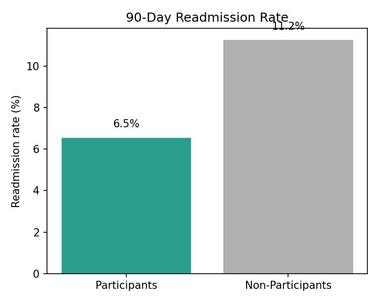
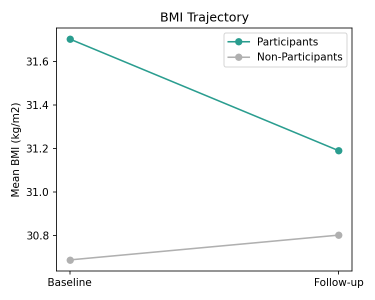

# Health Improvement Programs Analysis
### 🇸🇦 تحليل برامج تحسين الصحة
## 🇬🇧 English

### 📋 Overview
This project analyzes and compares health outcomes between patients who participated in a hospital-run **Health Improvement Program (HIP)** and a comparison group of patients who did not participate. The goal is to quantify whether structured program participation is associated with measurable improvements in key clinical indicators.

> **Note on data:** This analysis uses a **synthetic dataset** (500 simulated patient records) built to reflect realistic clinical patterns, created for portfolio and methodology-demonstration purposes. No real patient data is used.

### 🎯 Objective
Compare baseline vs. follow-up changes in BMI, blood pressure, HbA1c, and LDL cholesterol between program participants and non-participants, and assess differences in 90-day readmission rates.

### 🗂️ Dataset
| | |
|---|---|
| Total patients | 500 |
| Program participants | 260 |
| Non-participants (comparison group) | 240 |
| Departments covered | Cardiology, Endocrinology, Internal Medicine, Family Medicine |
| Follow-up window | 6–12 months |
| Fields tracked | Age, gender, department, baseline & follow-up BMI, systolic BP, HbA1c, LDL cholesterol, program adherence %, satisfaction score, 90-day readmission |

### 🔧 Tools Used
- **Python** — Pandas, NumPy (data generation & analysis), Matplotlib (visualization)
- **CSV** dataset for portability into Excel / Power BI

### 📊 Key Findings

**Average change in key metrics (follow-up vs. baseline):**

| Metric | Participants | Non-Participants | Difference |
|---|---|---|---|
| BMI (kg/m²) | −1.62 | +0.32 | **−1.94** |
| Systolic BP (mmHg) | −8.58 | +1.28 | **−9.86** |
| HbA1c (%) | −0.66 | +0.11 | **−0.76** |
| LDL Cholesterol (mg/dL) | −12.72 | +0.38 | **−13.10** |

- **90-day readmission rate:** 8.5% (participants) vs. 22.1% (non-participants) — a **13.6 percentage-point** reduction associated with program participation.
- **Average program adherence:** 78.1%
- **Average patient satisfaction:** 7.7 / 10

 

### 🧪 Statistical Tests
Run `statistical_tests.py` to reproduce these results.

- **Baseline balance:** the two groups were similar before the program on age, BMI, systolic BP, HbA1c, and LDL (all p > 0.05).
- **Change from baseline** (participants minus non-participants):

| Metric | Difference | 95% CI | Cohen's d | p-value |
|---|---|---|---|---|
| BMI (kg/m²) | −1.94 | −2.17 to −1.72 | −1.50 | < 0.001 |
| Systolic BP (mmHg) | −9.86 | −11.18 to −8.54 | −1.31 | < 0.001 |
| HbA1c (%) | −0.76 | −0.86 to −0.67 | −1.40 | < 0.001 |
| LDL Cholesterol (mg/dL) | −13.10 | −15.47 to −10.74 | −0.98 | < 0.001 |

- **90-day readmission:** the difference between groups is statistically significant (chi-square p < 0.001).
- **Adherence check:** among participants, program adherence shows almost no relationship with improvement (correlation between 0.00 and 0.05, all p > 0.45). In a real program, higher adherence would normally go with greater improvement, so this is another sign that the effect in this dataset is built in by design.

### 💡 Conclusion
In this simulated dataset, participants improved more than non-participants on all four clinical markers (BMI, systolic BP, HbA1c, LDL) and had a lower 90-day readmission rate. The two groups were similar at baseline, and every difference was statistically significant (see `statistical_tests.py`). However, these effects are built into the simulation by design, so they demonstrate the analytical method, not a real program result. The effect sizes are also much larger than most real programs achieve, which is another reason to treat the numbers as illustrative.

**Limitations:** This is a synthetic, illustrative dataset — it demonstrates the analytical approach, not a real clinical outcome. A production version would require IRB-approved real patient data, adjustment for confounders (e.g., baseline severity, comorbidities), and statistical significance testing.

### 📁 Repository Structure
```
health-improvement-programs-analysis/
├── health_improvement_programs_data.csv   # Full dataset (500 patients)
├── analyze.py                             # Analysis + chart generation script
├── statistical_tests.py                   # Baseline balance, t-tests, CIs, effect sizes
├── summary_results.csv                    # Summary comparison table
├── chart_metrics_comparison.png
├── chart_readmission_rate.png
├── chart_bmi_trajectory.png
└── README.md
```

### 📌 Project Status
Phase 2 complete: data pipeline, comparison analysis, visualizations, and statistical significance testing (`statistical_tests.py`). Next: a data-generation script and a Power BI interactive dashboard.

### 📫 Author
**Yosra El Nagar** — Nursing Supervisor transitioning into Healthcare Data Analytics
[LinkedIn](https://www.linkedin.com/in/yosra-nagar-9a6862118/)

---

## 🇸🇦 عربي

### 📋 نظرة عامة
مشروع تحليلي بيقارن بين نتائج المرضى اللي شاركوا في **برنامج تحسين الصحة (HIP)** التابع للمستشفى، ومجموعة مماثلة من المرضى اللي مشاركتش. الهدف قياس إذا كانت المشاركة المنظمة في البرنامج مرتبطة بتحسّن ملموس في المؤشرات الصحية الأساسية.

> **ملاحظة عن البيانات:** التحليل ده مبني على **بيانات وهمية (Synthetic)** — 500 سجل مريض تمت محاكاته ليعكس أنماط طبية واقعية، لأغراض البورتفوليو وتوضيح المنهجية. مفيش أي بيانات مرضى حقيقية مستخدمة.

### 🎯 الهدف
مقارنة التغيّر بين القياس الأساسي (Baseline) والمتابعة في مؤشر كتلة الجسم (BMI)، ضغط الدم، HbA1c، والكوليسترول الضار (LDL) بين المشاركين وغير المشاركين، وتقييم الفرق في معدل إعادة الدخول للمستشفى خلال 90 يوم.

### 🗂️ مجموعة البيانات
| | |
|---|---|
| إجمالي المرضى | 500 |
| المشاركين في البرنامج | 260 |
| غير المشاركين (مجموعة المقارنة) | 240 |
| الأقسام المشمولة | القلب، الغدد الصماء، الباطنة، طب الأسرة |
| فترة المتابعة | 6–12 شهر |

### 🔧 الأدوات المستخدمة
- **Python** — Pandas وNumPy لتوليد وتحليل البيانات، وMatplotlib للرسم البياني
- ملف **CSV** قابل للاستخدام مباشرة في Excel أو Power BI

### 📊 أهم النتائج

**متوسط التغيّر في المؤشرات الأساسية (المتابعة مقابل الأساسي):**

| المؤشر | المشاركون | غير المشاركين | الفرق |
|---|---|---|---|
| مؤشر كتلة الجسم (BMI) | −1.62 | +0.32 | **−1.94** |
| ضغط الدم الانقباضي (mmHg) | −8.58 | +1.28 | **−9.86** |
| HbA1c (%) | −0.66 | +0.11 | **−0.76** |
| الكوليسترول الضار LDL (mg/dL) | −12.72 | +0.38 | **−13.10** |

- **معدل إعادة الدخول خلال 90 يوم:** 8.5% (المشاركين) مقابل 22.1% (غير المشاركين) — انخفاض بمقدار **13.6 نقطة مئوية** مرتبط بالمشاركة في البرنامج.
- **متوسط الالتزام بالبرنامج:** 78.1%
- **متوسط رضا المرضى:** 7.7 من 10

### 🧪 الاختبارات الإحصائية
شغّل الملف `statistical_tests.py` لإعادة إنتاج النتائج دي.

- **التوازن في البداية:** المجموعتين كانوا متشابهين قبل البرنامج في العمر وBMI والضغط وHbA1c وLDL (كل قيم p أكبر من 0.05).
- **التغيّر عن القياس الأساسي:** كل الفروق في المؤشرات الأربعة دالة إحصائيًا (p أقل من 0.001)، وكمان الفرق في معدل إعادة الدخول خلال 90 يوم.
- **فحص الالتزام:** وسط المشاركين، الالتزام بالبرنامج مالوش علاقة تقريبًا بالتحسن (الارتباط بين 0.00 و0.05). في برنامج حقيقي المفروض اللي يلتزم أكتر يتحسن أكتر، وده دليل إضافي إن الأثر في البيانات دي مدمج في المحاكاة نفسها.

### 💡 الخلاصة
في البيانات الوهمية دي، المشاركين اتحسنوا أكتر من غير المشاركين في المؤشرات الأربعة، وكان معدل إعادة الدخول عندهم أقل. المجموعتين كانوا متشابهين في البداية، وكل الفروق دالة إحصائيًا (راجع `statistical_tests.py`). لكن الأثر ده مدمج في المحاكاة نفسها، فهو بيوضح المنهج التحليلي مش نتيجة برنامج حقيقي. وحجم الأثر أكبر بكتير من اللي بتحققه معظم البرامج الحقيقية.

**القيود:** البيانات دي وهمية وتوضيحية — بتعرض المنهج التحليلي مش نتيجة سريرية حقيقية. أي نسخة فعلية هتحتاج بيانات مرضى حقيقية معتمدة، وضبط للعوامل المربكة (زي شدة الحالة الأساسية والأمراض المصاحبة)، واختبار الدلالة الإحصائية.

### 📌 حالة المشروع
المرحلة التانية خلصت — خط أنابيب البيانات، تحليل المقارنة، الرسومات البيانية، والاختبارات الإحصائية. الخطوة الجاية: سكربت لتوليد البيانات وداشبورد تفاعلي على Power BI.

### 📫 التواصل
**يسرى النجار** — مشرفة تمريض في رحلة انتقال لتحليل البيانات الصحية
[LinkedIn](https://www.linkedin.com/in/yosra-nagar-9a6862118/)
